# SLO & Error Budget Definition

After estimating a design’s availability in Lab 1, you need to decide what reliability users should expect and how to judge whether the service delivers it. The purpose of this lab is to turn “the service should be reliable” into a clear, measurable target for an Orders API, a service that lets programs work with orders. You will define which requests count, what a successful response means, and how many failures are acceptable over 30 days.

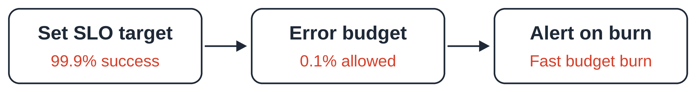

You will write a service level objective (SLO), build a Node.js calculator for its error budget—the number of failures the target allows—and create a Prometheus alert rule for when errors consume that budget too quickly. With 10,000,000 counted requests and a 99.9% target, you will calculate the failure allowance and how much remains after 4,000 failures. You will then check the alert rule’s syntax locally. This gives you practice making reliability decisions before connecting the rule to a running service.

By completing this lab, you will learn to distinguish a measured service level indicator (SLI) from an SLO target, classify good, bad, and excluded requests, and decide whether the example service meets its target. You will also learn how burn rate shows the speed of budget consumption and why an alert checks both a long and a short time window. These skills help a team agree on reliability expectations and recognize when failures need urgent investigation.

## Objective

By the end of this lab, you can:

- Define good, bad, and skipped requests.
- Set a 99.9% target over 30 days and calculate its budget.
- Write and validate a fast-burn alert.

## Deliverable

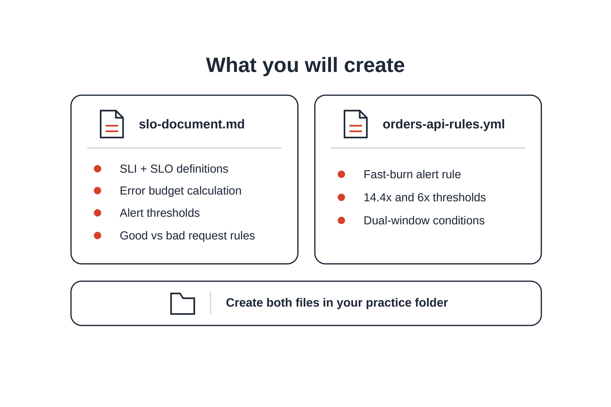

Create `slo-document.md`, `orders-api-rules.yaml`, and `calculate-budget.js`. YAML stores settings in text. Use `.yaml`; the diagram uses the equivalent `.yml` extension.

Record all three alert thresholds, or limits, in the document. Implement only the 14.4x fast rule in YAML; the diagram's 6x rule is outside this exercise.

## Understand SLI and SLO

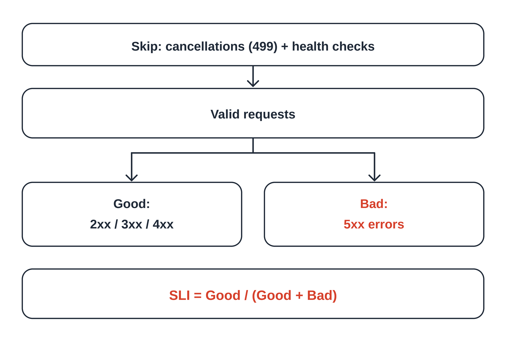

A service level indicator (SLI) measures reliability. A service level objective (SLO) sets its target: **99.9%** of counted requests without server errors over 30 days. Skip excluded requests, then count good and bad responses.

HTTP status codes describe responses. Count `2xx`, `3xx`, and `4xx` as good, except skipped `499` cancellations; count `5xx` as bad. Skip all `/healthz` health checks. A `404` counts as good here because this target measures server errors.

## Understand Error Budgets and Burn Rate

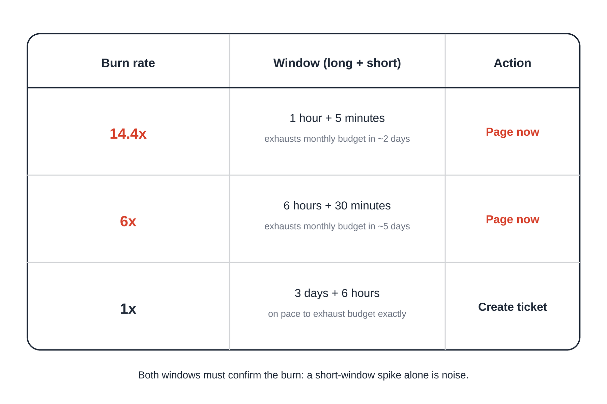

The error budget is the number of failures the target allows. A 99.9% target allows **0.1%** failures. Burn rate compares the observed error percentage with that allowance: `1.44% / 0.1% = 14.4x`.

A window is the period we look back over. Both a long and a short window must exceed the threshold, so an old outage alone does not trigger a new alert.

| Threshold | Long + short window | Errors | Action |
| --- | --- | --- | --- |
| Fast, 14.4x | 1 hour + 5 minutes | Above 1.44% | Urgent message |
| Medium, 6x | 6 hours + 30 minutes | Above 0.60% | Urgent message |
| Slow, 1x | 3 days + 6 hours | Above 0.10% | Create task |

At steady traffic and errors, 14.4x consumes a full 30-day budget in about **2.08 days**. This lab counts requests, not downtime minutes.

## Step 1: Define the Request Rules

```text
All requests -> skip 499 and /healthz -> good + bad
SLI = good / (good + bad) * 100
```

**Explanation:** Skipped requests enter neither count.

Apply these rules:

| Response | Count as | Reason |
| --- | --- | --- |
| `200` or `302` | Good | No server error |
| `404` | Good | Client error |
| `499` | Skip | Client cancelled |
| `500` or `504` | Bad | Server error |
| Any `/healthz` | Skip | Health check |

For 999 good and one bad request, the SLI is **99.9%**.

---

## Step 2: Write the Budget Calculator

Install Node.js in an Ubuntu/Debian terminal, or skip installation if you completed Lab 1:

```bash
sudo apt update
sudo apt install -y nodejs
```

**Explanation:** Installs the runtime for the JavaScript calculator.

```bash
node --version
```

**Explanation:** Prints the installed version, which may differ from the screenshot.

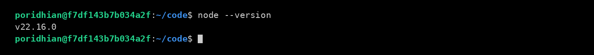

Create the practice folder and files:

```bash
mkdir -p m3-l2 && cd m3-l2
touch slo-document.md orders-api-rules.yaml calculate-budget.js
ls
```

**Explanation:** Creates three empty files and lists their names.

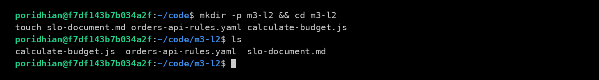

Open `m3-l2` in your editor.

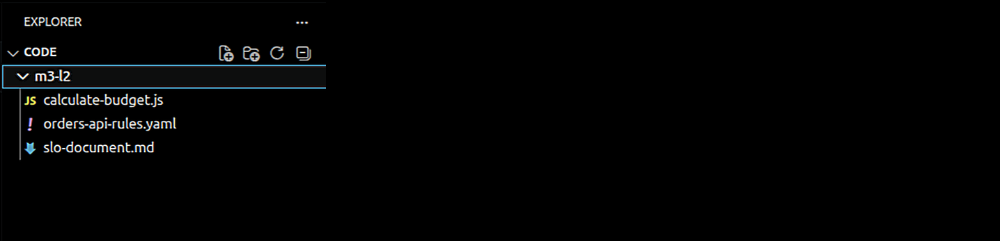

Use 10,000,000 counted requests and 4,000 errors from a rolling 30-day window, meaning the latest 30 days rather than a calendar month. Paste this into `calculate-budget.js`; no npm packages are needed.

```javascript
// Calculate the request-based error budget used in this lab.
const validRequests = 10_000_000;
const badRequests = 4_000;
const slo = 0.999;

const allowedFailures = Math.round(validRequests * (1 - slo));
const remaining = allowedFailures - badRequests;
const sli = (validRequests - badRequests) / validRequests * 100;
const budgetUsed = badRequests / allowedFailures * 100;
const budgetRemaining = remaining / allowedFailures * 100;

console.log("Valid requests:    ", validRequests.toLocaleString("en-US"));
console.log("SLO target:        ", (slo * 100).toFixed(1) + "%");
console.log("Allowed failures:  ", allowedFailures.toLocaleString("en-US"));
console.log("Actual failures:   ", badRequests.toLocaleString("en-US"));
console.log("Failures remaining:", remaining.toLocaleString("en-US"));
console.log("Budget used:       ", budgetUsed.toFixed(0) + "%");
console.log("Budget remaining:  ", budgetRemaining.toFixed(0) + "%");
console.log("Actual SLI:        ", sli.toFixed(2) + "%");

if (sli >= slo * 100) {
  console.log("SLO met:            Yes");
} else {
  console.log("SLO met:            No");
}
```

**What this file does:** Calculates allowed failures, remaining budget, and actual SLI.

The budget is `10,000,000 * 0.001 = 10,000`. Using 4,000 failures leaves 6,000, so **40%** is used and **60%** remains.

---

## Step 3: Write the SLO Document

```text
Request rules -> target -> failure allowance -> alert limits
```

**Explanation:** Record one shared definition of reliability for the team.

Save this complete document as `slo-document.md`:

```markdown
# Orders API SLO

## SLI
- Owner: Orders API team.
- Source: production gateway request counts.
- Valid: completed requests excluding 499 and /healthz.
- Good: valid HTTP 2xx, 3xx, or 4xx responses.
- Bad: valid HTTP 5xx responses, including 504.
- SLI = good / valid. Count retries separately.

## SLO
At least 99.9% good requests over the last 30 days.

## Error Budget
Allowed failures = valid requests * 0.001.

| Measure | Value |
| --- | --- |
| Valid requests | 10,000,000 |
| Allowed failures | 10,000 |
| Actual failures | 4,000 |
| Remaining failures | 6,000 |
| Budget used | 40% |
| Actual SLI | 99.96% |

## Alerts

| Speed | Windows | Burn | Errors | Action |
| --- | --- | --- | --- | --- |
| Fast | 1h + 5m | >14.4x | >1.44% | Page |
| Medium | 6h + 30m | >6x | >0.60% | Page |
| Slow | 3d + 6h | >1x | >0.10% | Ticket |
```

**What this file does:** Records request rules, ownership, the target, budget, and three alert thresholds.

A gateway receives requests before the service. A retry is another attempt; count each attempt separately.

---

## Step 4: Write the Alert Rule

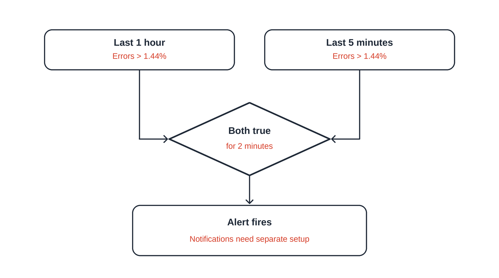

Prometheus collects measurements; PromQL calculates values from them. A counter increases as requests arrive. Save this rule as `orders-api-rules.yaml`:

```yaml
groups:
  - name: orders-api-slo
    rules:
      - alert: OrdersAPIErrorBudgetBurnFast
        for: 2m
        expr: |
          (
            1 - sum(rate(http_requests_total{job="orders-api",code!~"5..|499",route!="/healthz"}[1h]))
            / sum(rate(http_requests_total{job="orders-api",code!="499",route!="/healthz"}[1h]))
            > 0.0144
          )
          and
          (
            1 - sum(rate(http_requests_total{job="orders-api",code!~"5..|499",route!="/healthz"}[5m]))
            / sum(rate(http_requests_total{job="orders-api",code!="499",route!="/healthz"}[5m]))
            > 0.0144
          )
        labels:
          severity: page
        annotations:
          summary: "orders-api is burning its error budget fast"
```

**What this file does:** Defines a fast alert when both error percentages exceed 1.44% for two minutes.

Labels identify the service (`job`), response code (`code`), and path (`route`). `rate()` calculates requests per second, and `sum()` combines them. The expression calculates `1 - good / valid`; `0.0144` means 1.44% errors.

`and` requires both windows to exceed the limit. `for: 2m` requires that condition to continue for two minutes. Notifications need a running Prometheus setup with alert delivery configured.

---

## Step 5: Run the Calculator and Validate the Rule

From `m3-l2`, run the calculator:

```bash
node calculate-budget.js
```

**Explanation:** Prints the budget and measured good-request percentage.

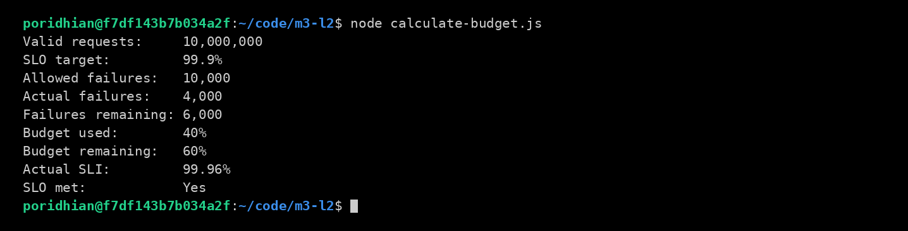

**What to expect:** **10,000** failures allowed, **6,000** remaining, and **40%** used. The **99.96%** SLI meets the target.

### Download the Rule Tool

Stay in `m3-l2`. These commands use `curl` and `tar` on Linux with a 64-bit Intel or AMD processor.

```bash
# paste this as one line
curl -fLO https://github.com/prometheus/prometheus/releases/download/v3.5.0/prometheus-3.5.0.linux-amd64.tar.gz
```

**Explanation:** Downloads the archive containing `promtool`, the rule-file validation tool.

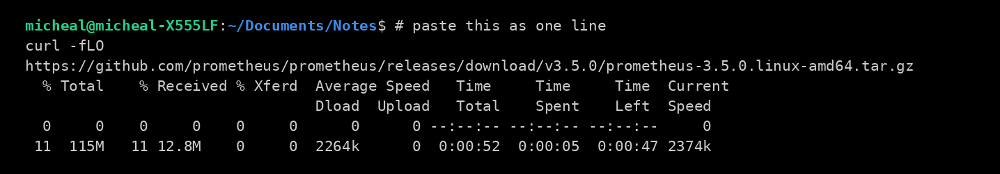

**What to expect:** The screenshot shows 11%; wait for 100% and the prompt before extracting.

### Extract the Tool

Extract only the validation tool:

```bash
# paste the tar command as one line
tar -xzf prometheus-3.5.0.linux-amd64.tar.gz prometheus-3.5.0.linux-amd64/promtool
ls prometheus-3.5.0.linux-amd64
```

**Explanation:** Extracts `promtool` and lists its folder.

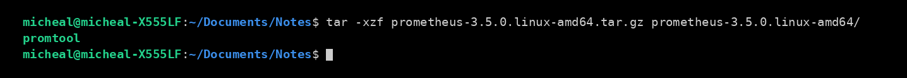

**What to expect:** `tar` prints nothing; `ls` prints `promtool`.

### Validate the Rule

From `m3-l2`, validate the rule:

```bash
./prometheus-3.5.0.linux-amd64/promtool check rules orders-api-rules.yaml
```

**Explanation:** Checks the YAML and PromQL rule syntax.

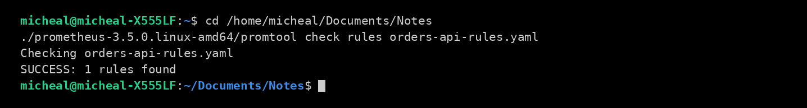

**What to expect:** `SUCCESS: 1 rules found`; this validates the file without sending alerts. The screenshot uses a different working directory; your prompt should show `m3-l2`.

---

## Conclusion

You have turned “the service should be reliable” into a measurable target: **at least 99.9% good requests over the latest 30 days**. Your request rules explain what counts as good, bad, or excluded, so everyone measures the same thing.

For **10,000,000 counted requests**, this target allows **10,000 failures**. With **4,000 failures**, the service has an SLI of **99.96%** and meets its target. It has used **40%** of its error budget, leaving **6,000 failures**, or **60%**, available in that window.

Your fast-burn rule checks whether errors exceed **1.44% in both the 1-hour and 5-minute windows for two minutes**. This helps identify a problem that is using the budget quickly. Passing `promtool check rules` confirms the rule’s syntax; sending notifications also needs a running Prometheus setup with alert delivery configured.

Keep the SLO document, calculator, and alert rule together as a shared reference. In Lab 3, you will check whether a proposed service design can support your reliability target.
