# Availability Math

When you design a service, choosing reliable servers is only part of the problem. A request may depend on a load balancer, an app, and a database. If any required part fails, users may lose access even when the other parts are working. The purpose of this lab is to help you estimate the availability of the whole service—the share of time it can work for users—and understand how its design affects expected downtime.

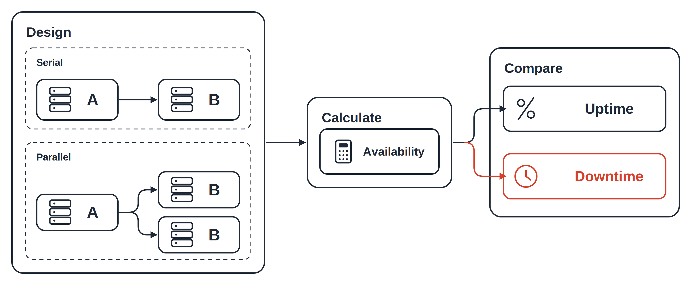

You will build a small Node.js calculator, describe a service in a CSV file, and compare required components in series with backup copies in parallel. You will then model a load balancer, two app copies, and a database, and improve the load balancer to see how the result changes. These exercises let you compare design choices before spending time setting up servers.

By completing this lab, you will learn to turn availability percentages and “nines” into expected downtime, calculate availability for different component arrangements, and explain why backup apps do not remove failures in shared dependencies. You will also learn when the calculations depend on assumptions such as independent failures. This gives you a way to justify which part of a design to improve and prepares you for setting reliability targets in Lab 2.

## Objective

By the end of this lab, you can:

- Explain availability and nines.
- Calculate availability for required parts and backup copies.
- Compare downtime and improve a shared dependency.

## Deliverable

A working calculator in `availability.js` and a system design in `components.csv`. A CSV is a text table with comma-separated columns.

## Understand Availability and Nines

```text
3 nines -> 99.9% working time -> 0.1% downtime
```

**Explanation:** Each extra nine reduces expected downtime to one tenth.

Availability is working time divided by total time. Three nines means 99.9%, or `0.999` in a formula. A 30-day month has 43,200 minutes; a 365-day year has 525,600 minutes.

| Nines | Availability | Downtime/month | Downtime/year |
| --- | --- | --- | --- |
| 2 | 99% | 432 min | 5,256 min |
| 3 | 99.9% | 43.2 min | 525.6 min |
| 4 | 99.99% | 4.32 min | 52.56 min |
| 5 | 99.999% | 0.432 min | 5.256 min |

Expected yearly downtime is `(1 - availability) * 525600`. It estimates a total, not when an outage will happen.

## Serial: Every Part Must Work

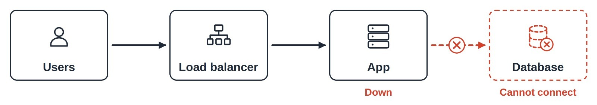

The request needs the load balancer, app, and database. For independent failures, multiply their availabilities: `0.999 * 0.999 = 0.998001`, or **99.8001%**. Independent means one failure does not change another part's failure chance. More required parts add more ways to fail.

## Parallel: One Copy Is Enough

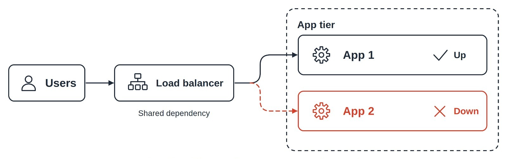

A replica is another copy doing the same job. Two independent three-nine apps fail together with probability `0.001 * 0.001`. Their group availability is `1 - 0.001 * 0.001 = 0.999999`, or **99.9999%**. The surviving copy must handle the traffic alone.

## Compare the Designs

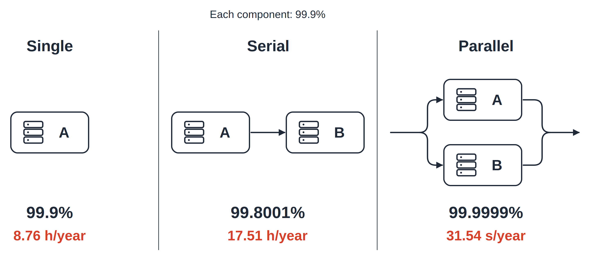

Every part below has 99.9% availability. The connections change the result.

| Design | Availability | Yearly downtime |
| --- | --- | --- |
| Single part | 99.9% | 8.76 hours |
| Two required parts | 99.8001% | 17.51 hours |
| Two alternative copies | 99.9999% | 31.54 seconds |

## Combined: Calculate the Group First

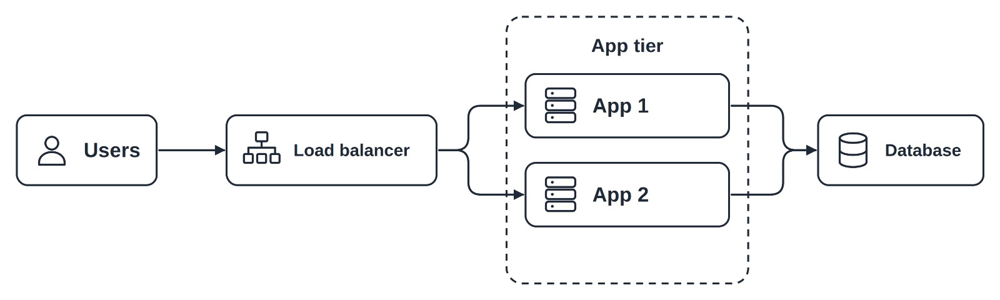

Read this as `LB -> (App 1 || App 2) -> DB`; `||` means alternatives. Calculate the app group first, then multiply the required tiers, or groups doing one role. With three-nine load balancer and apps, and a four-nine database, `0.999 * 0.999999 * 0.9999` gives **99.889910%**.

The load balancer and database are shared dependencies: either can stop both apps. Copies on one failed machine also fail together, so the independence assumption would not hold.

## Step 1: Create the Project

Install Node.js in an Ubuntu/Debian terminal. Skip installation if it is already available.

```bash
sudo apt update
sudo apt install -y nodejs
```

**Explanation:** Installs the runtime that runs JavaScript outside a browser.

```bash
node --version
```

**Explanation:** Prints your Node.js version, which may differ from the screenshot.

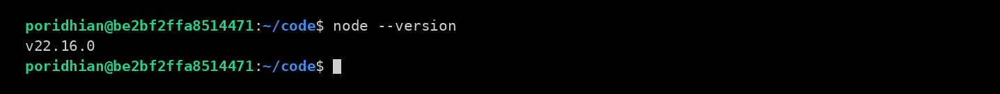

Create the project files:

```bash
mkdir -p m3-l1 && cd m3-l1
touch availability.js components.csv
ls
```

**Explanation:** Creates the folder and two empty files, then lists their names.

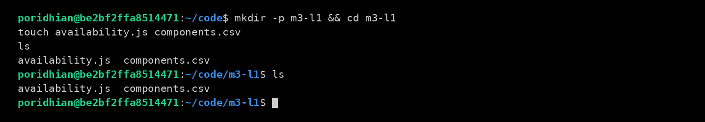

Open `m3-l1` in your editor. Both files should appear as shown; no npm packages are needed.

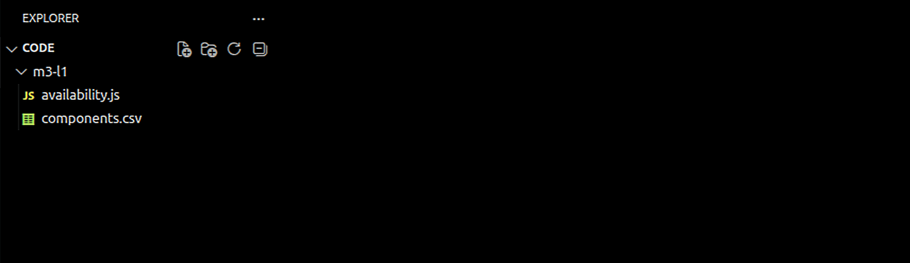

---

## Step 2: Write the Calculator

```text
Nines -> availability -> serial or parallel -> downtime
```

**Explanation:** Convert each input, combine the parts, then calculate downtime.

Paste this complete code into `availability.js`:

```javascript
const fs = require("node:fs");

// Convert 3 nines to 0.999, 4 nines to 0.9999, and so on.
function probability(nines) {
  if (!Number.isFinite(nines) || nines < 1 || nines > 9) {
    throw new Error("nines must be between 1 and 9");
  }
  return 1 - 10 ** -nines;
}

// Every required part must work: multiply their availabilities.
function serial(values) {
  let result = 1;
  for (const value of values) {
    result = result * value;
  }
  return result;
}

// One copy is enough: find the chance that all copies fail.
function parallel(values) {
  let allFail = 1;
  for (const value of values) {
    allFail = allFail * (1 - value);
  }
  return 1 - allFail;
}

function report(label, availability) {
  const downtime = 1 - availability;
  let nines = "beyond precision";
  if (downtime > 0) {
    nines = (-Math.log10(downtime)).toFixed(3);
  }
  console.log(label);
  console.log("  availability:", (availability * 100).toFixed(6) + "%");
  console.log("  nines:", nines);
  console.log("  downtime:", (downtime * 43200).toFixed(2), "min/month");
  console.log("           ", (downtime * 525600).toFixed(2), "min/year");
  console.log();
}

function readSystem(path) {
  const text = fs.readFileSync(path, "utf8");
  const lines = text.trim().split(/\r?\n/);
  if (lines[0] !== "component,nines,group") {
    throw new Error("CSV header must be component,nines,group");
  }
  const groups = Object.create(null);

  // Skip the header, then put components into their groups.
  for (const line of lines.slice(1)) {
    if (!line.trim()) continue;
    const cells = line.split(",");
    if (cells.length !== 3 || cells.some((cell) => !cell.trim())) {
      throw new Error("each row needs a component, nines, and group");
    }
    const nines = Number(cells[1]);
    const group = cells[2].trim();
    if (!groups[group]) groups[group] = [];
    groups[group].push(probability(nines));
  }

  // Copies within a group are parallel; the groups are required.
  const tiers = [];
  for (const copies of Object.values(groups)) {
    tiers.push(parallel(copies));
  }
  if (tiers.length === 0) throw new Error("CSV must contain components");
  return serial(tiers);
}

function demo() {
  const app = probability(3);
  const database = probability(4);
  const appGroup = parallel([app, app]);

  report("single 99.9%", app);
  report("serial 99.9% + 99.9%", serial([app, app]));
  report("parallel 99.9% || 99.9%", appGroup);
  report("combined LB -> (API || API) -> DB",
    serial([app, appGroup, database]));
}

// Read the command typed after: node availability.js
const command = process.argv[2];
const csvPath = process.argv[3];

try {
  if (command === "--demo" && process.argv.length === 3) {
    demo();
  } else if (command === "--csv" && csvPath && process.argv.length === 4) {
    report("SYSTEM", readSystem(csvPath));
  } else if (command === "--nines") {
    // Example: --nines 3 3 --topology parallel
    const args = process.argv.slice(3);
    const topology = args.pop();
    const flag = args.pop();
    if (flag !== "--topology" || args.length === 0 ||
        (topology !== "serial" && topology !== "parallel")) {
      throw new Error("Use --nines 3 3 --topology serial or parallel");
    }
    const values = [];
    for (const input of args) {
      values.push(probability(Number(input)));
    }
    if (topology === "serial") report("serial", serial(values));
    else report("parallel", parallel(values));
  } else {
    throw new Error("Use --demo, --csv components.csv, or --nines 3 3 --topology serial");
  }
} catch (error) {
  console.error("Error:", error.message);
  process.exitCode = 1;
}
```

**What this file does:** Calculates availability and downtime from built-in examples, CSV groups, or direct nines inputs.

---

## Step 3: Write the System CSV

```text
lb group -> api group (two copies) -> db group
```

**Explanation:** Copies in one group are alternatives; different groups are required.

Save this design in `components.csv`:

```csv
component,nines,group
LB-1,3,lb
API-server-1,3,api
API-server-2,3,api
DB-primary,4,db
```

**What this file does:** Defines one load balancer, two alternative apps, and one database.

Use `3` for three nines, not `99.9`. Keep the header exactly as shown and avoid commas or quotation marks inside field values.

---

## Step 4: Run the Calculator

From `m3-l1`, run the built-in examples:

```bash
node availability.js --demo
```

**Explanation:** Prints four designs without reading your CSV.

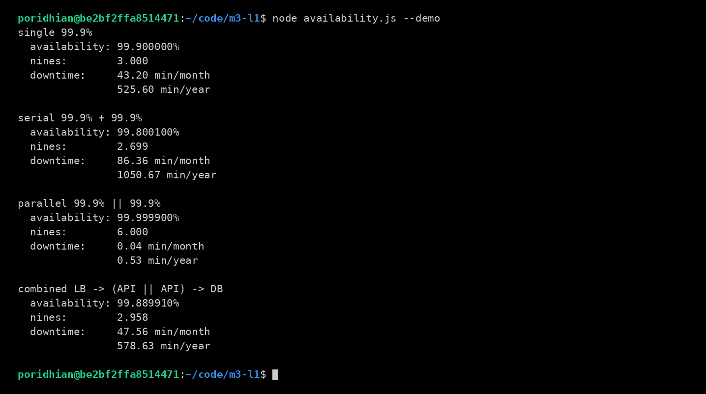

**What to expect:** The combined design has **99.889910%** availability and **578.63 minutes/year** of downtime.

Calculate your saved design:

```bash
node availability.js --csv components.csv
```

**Explanation:** Reads the CSV and prints the system report.

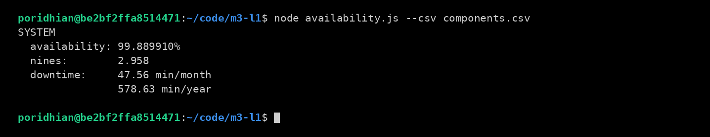

**What to expect:** The result matches the demo's combined design.

Compare two components directly:

```bash
node availability.js --nines 3 3 --topology serial
node availability.js --nines 3 3 --topology parallel
```

**Explanation:** Uses the same inputs with two different connection types.

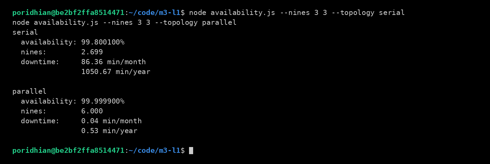

**What to expect:** Serial downtime is **1050.67 minutes/year**; parallel downtime is **0.53 minutes/year**.

Change `LB-1,3,lb` to `LB-1,4,lb` in `components.csv`, save it, and run again:

```bash
node availability.js --csv components.csv
```

**Explanation:** Recalculates the system with a four-nine load balancer.

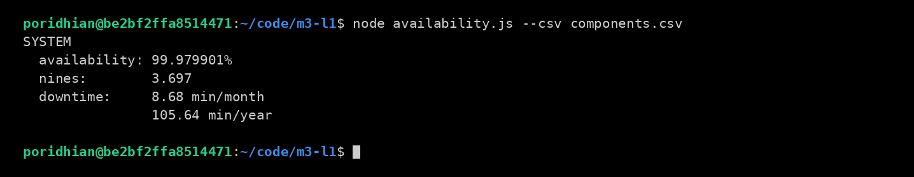

**What to expect:** Availability rises to **99.979901%** and downtime falls to **105.64 minutes/year**. The demo keeps its original values.

---

## Conclusion

You have learned how to estimate a service’s availability from the parts it depends on. When every part must work, multiply their availabilities. When either of two copies can handle a request, calculate the chance that both copies fail to find the tier’s availability.

In this example, two app copies still depend on one load balancer and one database. Improving the load balancer raises predicted availability from **99.889910% to 99.979901%** and reduces expected downtime from **578.63 to 105.64 minutes per year**. This shows why you need to check the whole request path when deciding what to improve.

Use `availability.js` and `components.csv` to compare other designs. These estimates depend on the model’s assumptions, including independent failures. In Lab 2, you will set a reliability target and calculate how many failed requests that target allows.
