# Topology Driven Reliability Modeling

A service can have reliable parts and still fail too often as a whole. For example, an order needs Gateway, Orders, Inventory, and Database to work together. If any required part fails, the request can fail. Before choosing a reliability target, we need to understand how these dependencies affect availability, the share of time a service can handle requests.

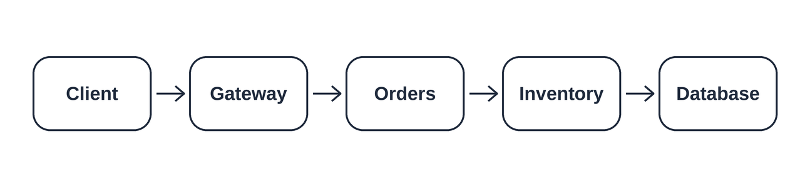

In this lab, you will model this request path and compare two designs: one with a single copy of each part, and one with extra Orders and Inventory copies. The purpose is to estimate whether a design can meet a success target before deploying it. You will also see why adding copies helps and why it does not remove every source of failure.

The steps build on each other. First, write the design in YAML so its parts and availability assumptions are clear. Next, calculate availability by hand to understand the formulas, then use Node.js to check your answers. Add extra copies and compare the results to see how a design change affects predicted failures. Finally, write a target and a short report to explain your choice and how you would check it using real requests.

By the end, you will know how to connect a service design to a reliability target, explain your calculations, and recognize the limits of a model. The calculations help you plan; live measurements show whether the service actually meets its target.

## Objective

By the end of this lab, you can:

- Describe a service in YAML.
- Calculate availability for required parts and extra copies.
- Compare the original and improved designs to see how extra copies affect reliability.
- Choose an SLO target using the predicted failures and error budget.
- Explain your recommendation and how to check it against real requests.

During the lab, you will create and submit six files:

| File | What to include |
| --- | --- |
| `topology.yaml` | The original design, with one copy of each required tier and its availability. |
| `topology-improved.yaml` | The improved design, with extra Orders and Inventory copies. |
| `calculations.md` | Your availability calculations for both designs. |
| `analyze_topology.js` | A calculator that reads either design and estimates availability, downtime, and failed requests. |
| `slo-document.md` | Your chosen reliability target, request-counting rules, and error budget. |
| `reliability-report.md` | A comparison of the results, your recommended design, and the assumptions to check in a running service. |

## Understand required tiers


A tier is one required part of the service. Every request needs Gateway, Orders, Inventory, and Database, so multiply their availabilities. The client is outside the calculation.

## Understand extra copies

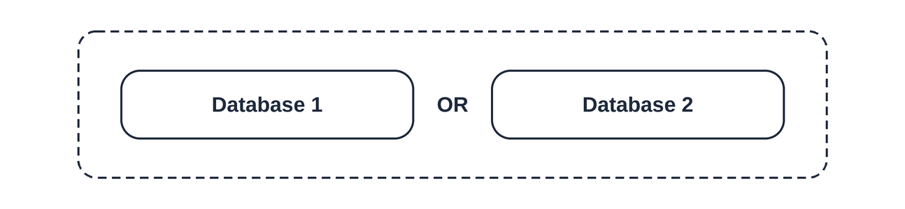

A replica is an extra copy that does the same job. A parallel tier fails only when every copy fails. This diagram illustrates database copies; our improved design adds Orders and Inventory copies instead.

```text
A_tier = 1 - (1 - A_copy1) x (1 - A_copy2)
A_system = A_gateway x A_orders x A_inventory x A_database
```

**Explanation:** Use decimals, such as 0.999 for 99.9%.

Assume independent failures, immediate routing to a working copy, and enough capacity in one copy. Shared failures, retries, and switching delays are excluded. These availability values are practice inputs, not measurements.

## Understand SLOs

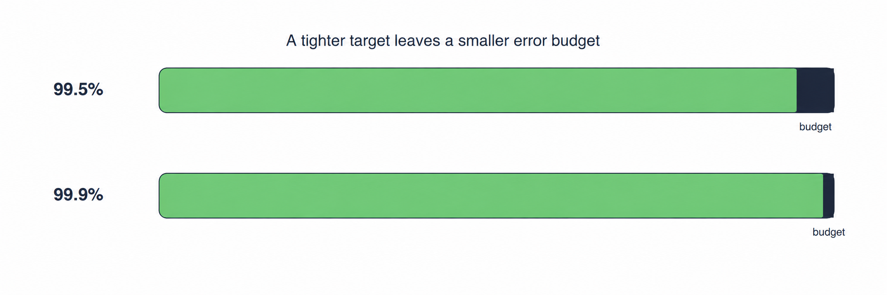

A service level objective (SLO) is a success target. Its error budget is the allowed number of failures. The drawing enlarges the budgets for visibility; use the numbers below.

| Target | Failure allowance | Failures per 1,000,000 requests | Equivalent minutes in 30 days |
|---|---|---|---|
| 99.5% | 0.5% | 5,000 | 216 |
| 99.9% | 0.1% | 1,000 | 43.2 |

---

## Step 1: Create the lab folder

Use Bash, a text editor, and Node.js with npm. This lab models a service; no service deployment is needed.

```bash
mkdir -p reliability-lab
cd reliability-lab
```

**Explanation:** Create the workspace and run all remaining commands here.

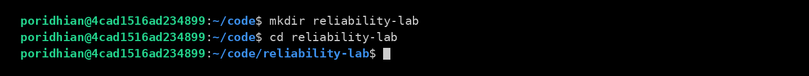

---

## Step 2: Write the baseline topology

```bash
touch topology.yaml
```

**Explanation:** Create the file, then paste the YAML below in your editor.

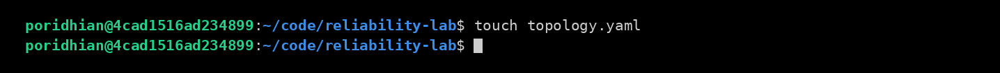

```yaml
service: ordering-api
window_days: 30
monthly_valid_requests: 1000000
slo_targets_percent: [99.5, 99.9]

# Tiers are required in series. A request must pass through every tier.
# Copies inside a tier are interchangeable parallel replicas.
tiers:
  - name: gateway
    copies:
      - availability_percent: 99.95

  - name: orders
    copies:
      - availability_percent: 99.9

  - name: inventory
    copies:
      - availability_percent: 99.9

  - name: database
    copies:
      - availability_percent: 99.99
```

**What this file does:** Defines four required tiers with one copy each.

Use spaces for indentation. Database represents one logical managed multi-AZ service; its assumed internal redundancy is already included in 99.99%.

---

## Step 3: Calculate both error budgets

```bash
touch calculations.md
```

**Explanation:** Create your written calculation file.

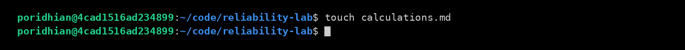

Write the following working in `calculations.md`. A 30-day window contains 43,200 minutes. Keep full precision until the final answer.

```markdown
# Availability calculations

## Baseline
A = 0.9995 x 0.999 x 0.999 x 0.9999 = 0.99740224934995
Availability = A x 100 = 99.740225% (rounded)
Unavailable fraction = 1 - A
Downtime = (1 - A) x 43200 = 112.22 minutes
Nines = -log10(1 - A) = 2.585
Predicted failures = (1 - A) x 1000000 = 2598 (rounded)

## SLO comparison
99.5% budget = (1 - 0.995) x 1000000 = 5000 failures
99.9% budget = (1 - 0.999) x 1000000 = 1000 failures
The baseline meets 99.5% but misses 99.9% in this model.
```

**What this file does:** Records the baseline formulas and compares predicted failures with both budgets.

Nines describe closeness to 100%: 99% is two nines and 99.9% is three. Failed-request estimates assume constant traffic; downtime during busy periods can cause more failures.

---

## Step 4: Write the calculator

```bash
node --version
npm --version
```

**Explanation:** Confirm both tools are installed; otherwise install Node.js with npm before continuing. Your versions may differ from the screenshot.

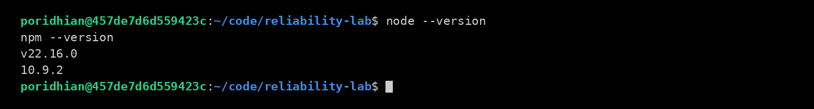

```bash
npm init -y
```

**Explanation:** Create the local Node.js project.

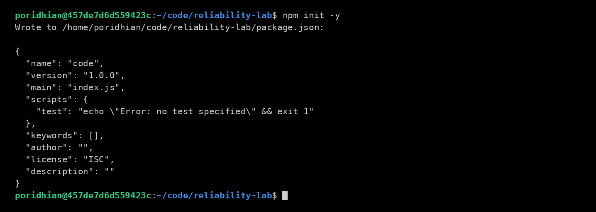

```bash
npm install yaml@2
```

**Explanation:** Install the package used to read YAML.

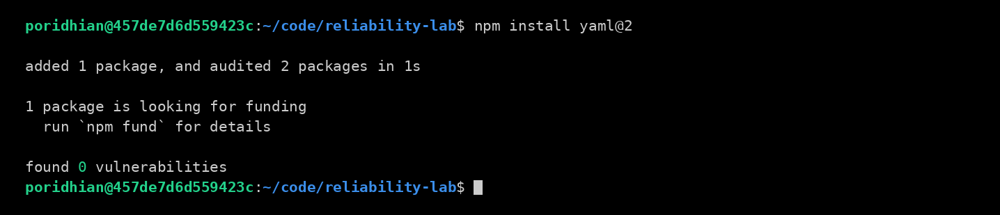

```bash
node -e "require('yaml'); console.log('YAML is ready')"
```

**Explanation:** Confirm the YAML package loads before continuing.

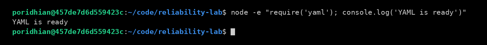

```bash
touch analyze_topology.js
```

**Explanation:** Create the calculator file and paste the complete code below.


```javascript
const fs = require('node:fs');
const YAML = require('yaml');

function required(mapping, key, location) {
  if (mapping === null || typeof mapping !== 'object' || Array.isArray(mapping)) {
    throw new Error(`${location} must be a YAML mapping`);
  }
  if (!Object.prototype.hasOwnProperty.call(mapping, key)) {
    throw new Error(`${location}: missing required key '${key}'`);
  }
  return mapping[key];
}

function number(value, location, upper = Infinity) {
  if (typeof value !== 'number' || !Number.isFinite(value) || value <= 0 || value > upper) {
    const bounds = Number.isFinite(upper) ? `above 0 and at most ${upper}` : 'above 0';
    throw new Error(`${location} must be a finite number ${bounds}, got ${String(value)}`);
  }
  return value;
}

function nonemptyList(value, location) {
  if (!Array.isArray(value) || value.length === 0) {
    throw new Error(`${location} must be a non-empty list`);
  }
  return value;
}

function parallelAvailability(copies) {
  nonemptyList(copies, 'copies');
  let unavailability = 1;
  for (const copy of copies) {
    const percent = number(required(copy, 'availability_percent', 'copy'),
      'availability_percent', 100);
    unavailability *= 1 - percent / 100;
  }
  return 1 - unavailability;
}

function serialAvailability(tierAvailabilities) {
  return tierAvailabilities.reduce((total, availability) => total * availability, 1);
}

function loadTopology(path) {
  const data = YAML.parse(fs.readFileSync(path, 'utf8'));
  for (const key of ['service', 'window_days', 'monthly_valid_requests',
    'slo_targets_percent', 'tiers']) {
    required(data, key, 'topology');
  }
  if (typeof data.service !== 'string' || !data.service.trim()) {
    throw new Error('service must be a non-empty string');
  }
  number(data.window_days, 'window_days');
  const requests = number(data.monthly_valid_requests, 'monthly_valid_requests');
  if (!Number.isSafeInteger(requests)) {
    throw new Error('monthly_valid_requests must be a positive safe integer');
  }
  for (const slo of nonemptyList(data.slo_targets_percent, 'slo_targets_percent')) {
    number(slo, 'slo_targets_percent entry', 100);
  }
  nonemptyList(data.tiers, 'tiers').forEach((tier, index) => {
    const location = `tiers[${index}]`;
    const name = required(tier, 'name', location);
    if (typeof name !== 'string' || !name.trim()) {
      throw new Error(`${location}.name must be a non-empty string`);
    }
    const copies = nonemptyList(required(tier, 'copies', location), `${location}.copies`);
    copies.forEach((copy, copyIndex) => {
      const copyLocation = `${location}.copies[${copyIndex}]`;
      number(required(copy, 'availability_percent', copyLocation),
        `${copyLocation}.availability_percent`, 100);
    });
  });
  return data;
}

function main() {
  const path = process.argv[2] || 'topology.yaml';
  const data = loadTopology(path);
  const tierAvailabilities = data.tiers.map(tier => parallelAvailability(tier.copies));
  const aSystem = serialAvailability(tierAvailabilities);
  const minutesInWindow = data.window_days * 24 * 60;

  console.log(`Loaded topology: ${data.service}`);
  console.log(`Tiers in series: ${data.tiers.map(tier => tier.name).join(', ')}`);
  console.log(`System availability   : ${(aSystem * 100).toFixed(6)}%`);

  let downtime;
  if (aSystem >= 1) {
    // log10(0) is undefined, so 100% modeled availability is a special case.
    console.log('Equivalent nines      : infinite (100% modeled availability)');
    downtime = 0;
  } else {
    const nines = -Math.log10(1 - aSystem);
    downtime = (1 - aSystem) * minutesInWindow;
    console.log(`Equivalent nines      : ${nines.toFixed(3)}`);
  }
  console.log(`Monthly downtime      : ${downtime.toFixed(2)} minutes`);
  console.log();

  const validRequests = data.monthly_valid_requests;
  const predictedFailed = (downtime / minutesInWindow) * validRequests;
  for (const slo of data.slo_targets_percent) {
    const budget = validRequests * (100 - slo) / 100;
    const verdict = predictedFailed <= budget ? 'MODEL PASS' : 'MODEL FAIL';
    console.log(`SLO ${slo}%  budget ${budget.toFixed(0)} failed requests   -> ${verdict}`);
  }
  console.log(`Predicted failed requests this month: ${predictedFailed.toFixed(0)}`);
  console.log('MODEL PASS means the model meets this SLO. It is not a measurement of real traffic.');
}

try {
  main();
} catch (error) {
  console.error(`Error: ${error.message}`);
  process.exitCode = 1;
}
```

**What this file does:** Validates the YAML, calculates availability, and compares predicted failures with each SLO budget.

Use the CommonJS project created above. Invalid YAML, missing fields, or invalid numbers produce an `Error:` message and a nonzero exit status.

---

## Step 5: Add service copies

```bash
cp topology.yaml topology-improved.yaml
```

**Explanation:** Copy the baseline, then replace the new file with this design.

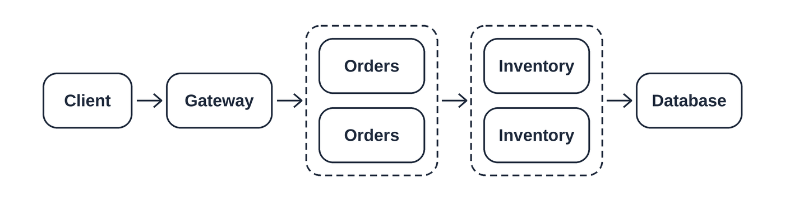

```yaml
service: ordering-api
window_days: 30
monthly_valid_requests: 1000000
slo_targets_percent: [99.5, 99.9]

tiers:
  - name: gateway
    copies:
      - availability_percent: 99.95

  - name: orders
    copies:
      - availability_percent: 99.9
      - availability_percent: 99.9

  - name: inventory
    copies:
      - availability_percent: 99.9
      - availability_percent: 99.9

  - name: database
    copies:
      - availability_percent: 99.99
```

**What this file does:** Adds a second Orders copy and a second Inventory copy.

Append this working to `calculations.md`:

```markdown
## Improved design
A_orders = 1 - (1 - 0.999)^2 = 0.999999
A_inventory = 1 - (1 - 0.999)^2 = 0.999999
A = 0.9995 x 0.999999 x 0.999999 x 0.9999
Availability = A x 100 = 99.939805% (rounded)
Downtime = (1 - A) x 43200 = 26.00 minutes
Nines = -log10(1 - A) = 3.220
Predicted failures = (1 - A) x 1000000 = 602 (rounded)
The improved model meets both targets.
```

**What this file does:** Adds the parallel-tier calculation and improved results.

Gateway and the logical Database remain required single tiers. Either can still stop the service.

---

## Step 6: Write the SLO document

```bash
touch slo-document.md
```

**Explanation:** Create the target document and fill it using these headings.

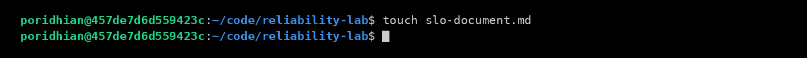

```markdown
# SLO Document, ordering-api

## Service boundary
Include Gateway, Orders, Inventory, and Database. Exclude the client.
Following Lab 02, skip 499 responses and /healthz requests.
Count remaining 2xx, 3xx, and 4xx responses as good; count 5xx as bad.
SLI (service level indicator) = good requests / all counted requests.

## Measurement window
Use the most recent 30 days, a rolling window.

## Targets to compare
At 1,000,000 counted requests, 99.5% allows 5,000 failures
and 99.9% allows 1,000. Recalculate budgets when traffic changes.

## Selected target
Choose 99.9% for topology-improved.yaml.
Its modeled availability is 99.939805%.

## Production measurement
Count good and bad responses at the gateway.
Use external checks to detect failures that never reach the gateway.
Check the live SLI against the target.
```

**What this file does:** Defines the target, counted requests, and measurement plan.

---

## Step 7: Write the reliability report

```bash
touch reliability-report.md
```

**Explanation:** Create a report of about one page using the structure below.

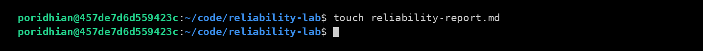

```markdown
# Reliability Report, ordering-api

## Service and assumptions
Client -> [Gateway -> Orders -> Inventory -> Database]
Calculate only the bracketed tiers. Assume independent failures,
immediate routing, constant traffic, and sufficient replica capacity.

## Results over 30 days
| Metric | Baseline | Improved |
|---|---|---|
| Availability | 99.740225% | 99.939805% |
| Nines | 2.585 | 3.220 |
| Downtime | 112.22 minutes | 26.00 minutes |
| Predicted failures | 2,598 | 602 |
| Meets 99.5% | Yes | Yes |
| Meets 99.9% | No | Yes |

## Recommendation
Add one Orders copy and one Inventory copy. Choose a 99.9% SLO.
Improve Gateway and Database next because either can stop the service.

## Limitations
Shared failures and switching delays can lower real availability.
Retries and backup paths can change results. Traffic varies, so use
live request counts to determine whether the service meets its SLO.
```

**What this file does:** Compares both designs and explains the recommendation and limits.

---

## Step 8: Run and compare both designs

Save all six files before running. `package.json`, `package-lock.json`, and `node_modules/` support local execution; submit the six deliverables.

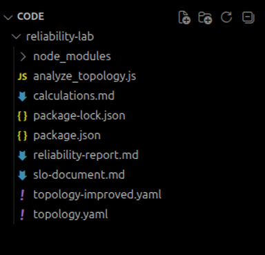

```bash
node analyze_topology.js topology.yaml
```

**Explanation:** Calculate the baseline and compare both targets.

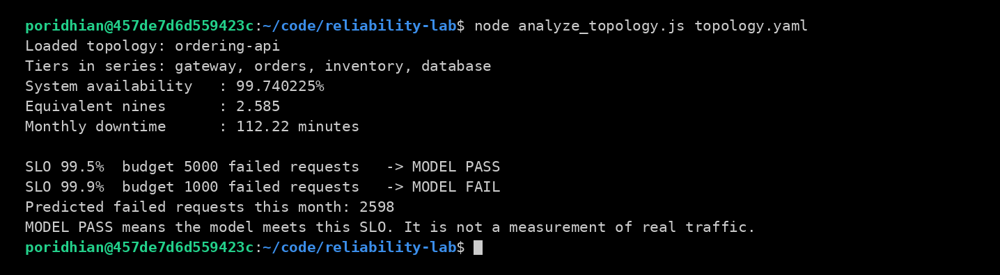

```bash
node analyze_topology.js topology-improved.yaml
```

**Explanation:** Calculate the improved design using the same calculator.

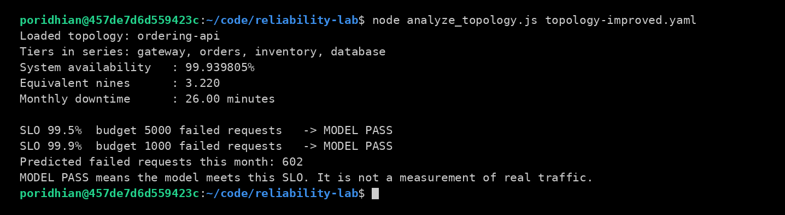

**What to expect:** Baseline availability is 99.740225%, with 2,598 predicted failures. Improved availability is 99.939805%, with 602 predicted failures. Compare these results with your calculations and correct any differences.

`MODEL PASS` describes the model, not measured traffic. `MODEL FAIL` does not mean the command failed. Missing files require checking your folder; YAML errors require checking indentation. If `yaml` cannot load, repeat its installation in this folder.

---

## Conclusion

You have compared two service designs and used their predicted failures to choose a reliability target. Writing the designs in YAML and checking them with the same calculator makes the comparison easier to repeat when the design changes.

With one copy of each tier, the model predicts **99.740225% availability** and about **2,598 failed requests per 1,000,000**. Adding an Orders copy and an Inventory copy improves the prediction to **99.939805%** and about **602 failures**. A **99.9% target** allows **1,000 failures**, so the improved design fits that budget while the original design exceeds it.

The extra copies help because either copy can serve a request. Gateway and Database remain shared dependencies: either one can still stop the request path. The prediction also depends on assumptions such as independent failures and immediate routing to a working copy.

Use your report to explain why you recommend the improved design. Once the service is running, measure real requests to check whether it meets the SLO. In Lab 4, you will apply these calculations and targets to a URL shortener and record a baseline for future design changes.
