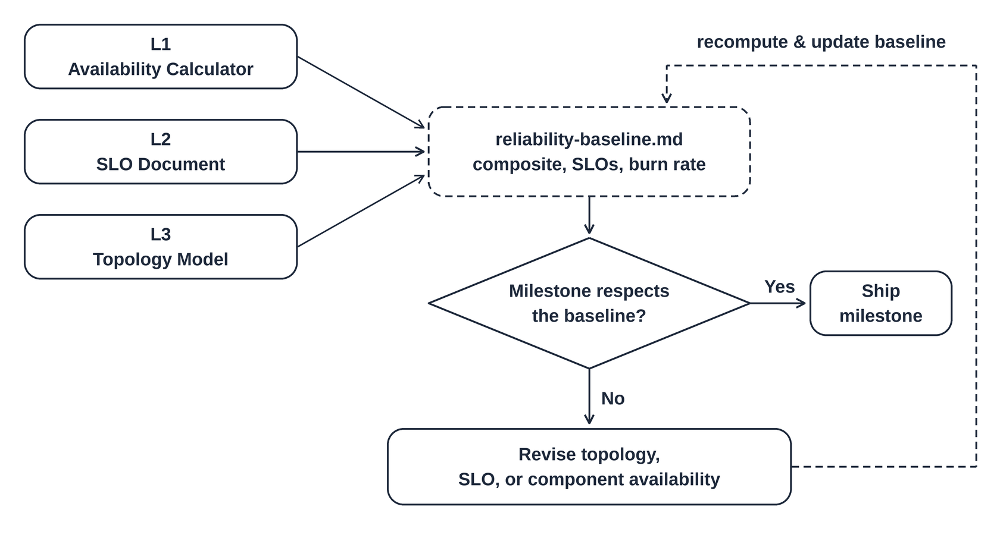
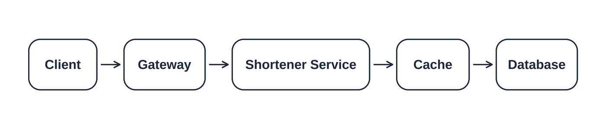
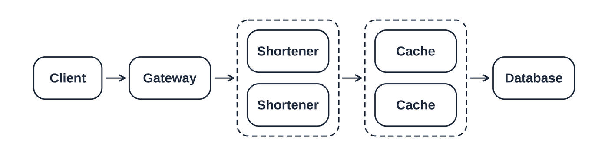
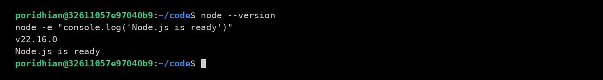
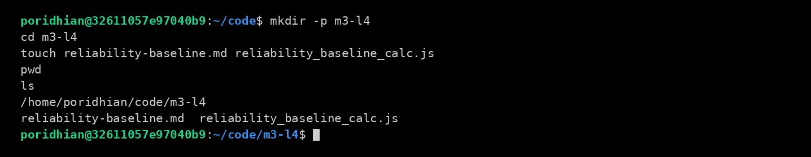
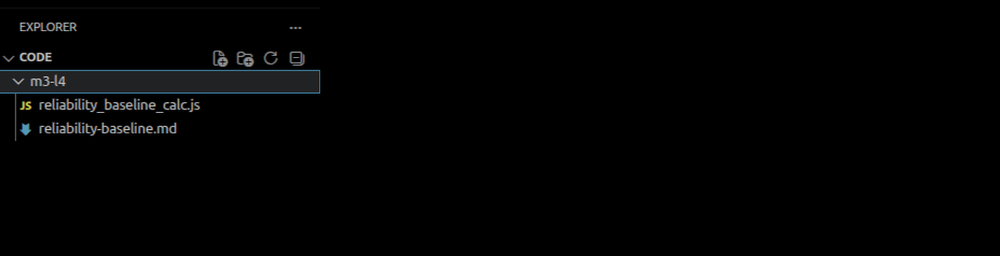
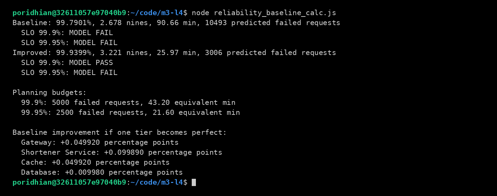

# Reliability Baseline for a URL Shortener

Before building a URL shortener, you need to decide how reliable it should be and whether your design can support that goal. A service may have backup copies and still fail because every request depends on other parts. The purpose of this lab is to combine the availability math from Lab 1, the reliability targets from Lab 2, and the design modeling from Lab 3 into one reliability baseline: a written reference for checking future design changes.



You will use Node.js to compare a design with one copy of each component against a design with extra Shortener Service and Cache copies. You will calculate expected downtime and failed requests, compare them with reliability targets, and record your decision in `reliability-baseline.md`. This teaches you how to connect a design choice, such as adding a replica, to a measurable result.

These skills matter because teams need evidence when choosing what to improve and what reliability to promise users. By the end, you will be able to explain which target the model supports, which dependencies still limit it, and when errors should trigger an alert. You will also understand why a prediction needs assumptions and must later be checked against live requests. Your baseline will help you review later milestones whenever the service design changes.

## Objective

```text
Model -> calculate -> choose a target -> record the decision
```

**Explanation:** Connect design choices to expected failures.

By the end, you can:

- Calculate availability, downtime, and equivalent nines.
- Choose a service level objective (SLO), a target for successful requests.
- Record failure allowances and alert thresholds.

## Deliverable

```text
reliability_baseline_calc.js + reliability-baseline.md
```

**Explanation:** Submit the calculator and a report explaining its results.

## Required dependencies



Every modeled request needs all four tiers. Exclude the client. Real cache hits may skip Database; this simplified model assumes otherwise.

## Parallel copies



Replicas are interchangeable copies with the required data and full traffic capacity. Assume independent failures, immediate routing, and no shared failures or switching delays. Database availability includes internal redundancy.

## Step 1: Install Node.js and create the files

```text
Check Node.js -> install if missing -> create files -> open editor
```

**Explanation:** Prepare an Ubuntu/Debian terminal and a text editor.

Check Node.js first; skip installation if this succeeds:

```bash
node --version
```

**Explanation:** Prints your installed version.

If Node.js is missing, install it:

```bash
sudo apt update
sudo apt install -y nodejs
```

**Explanation:** Refreshes package information and installs the JavaScript runtime.

Confirm it works:

```bash
node --version
node -e "console.log('Node.js is ready')"
```

**Explanation:** Prints the version and a readiness message.



Your version may differ. No npm packages are needed.

```bash
mkdir -p m3-l4
cd m3-l4
touch reliability-baseline.md reliability_baseline_calc.js
pwd
ls
```

**Explanation:** Creates both files and confirms the working directory.



Open `m3-l4` in your editor. Run remaining commands here.



---

## Step 2: Record the assumptions

```text
Tier availability + copy counts + traffic -> model inputs
```

**Explanation:** Record these inputs in your report using Step 7's template.

| Tier | Availability | Baseline copies | Improved copies |
| --- | --- | --- | --- |
| Gateway | 99.95% | 1 | 1 |
| Shortener Service | 99.90% | 1 | 2 |
| Cache | 99.95% | 1 | 2 |
| Database | 99.99% | 1 logical | 1 logical |

Use 30 days, 43,200 minutes, and 5,000,000 uniformly distributed requests. These are practice assumptions.

Skip 499 and `/healthz`. Count remaining completed 2xx/3xx/4xx as good and 5xx as bad. The service level indicator (SLI) is `good / valid`. Count live retries separately; check failures before Gateway externally.

---

## Step 3: Write the calculator

```text
Parallel copies -> required tiers -> downtime and budgets
```

**Explanation:** Combine copies first, then multiply required tier availability.

Save this code in `reliability_baseline_calc.js`. Nines use `-log10(1 - availability)`; 99.9% means three nines.

```javascript
const WINDOW_DAYS = 30;
const VALID_REQUESTS = 5_000_000;
const SLO_TARGETS = [99.9, 99.95];
const BASELINE = {
  Gateway: 0.9995,
  "Shortener Service": 0.999,
  Cache: 0.9995,
  Database: 0.9999,
};

function serial(values) {
  return values.reduce((total, availability) => total * availability, 1);
}

function parallel(...copies) {
  const allFail = copies.reduce((total, availability) =>
    total * (1 - availability), 1);
  return 1 - allFail;
}

function summarize(tiers) {
  const availability = serial(Object.values(tiers));
  const failedFraction = 1 - availability;
  const nines = failedFraction === 0 ? Infinity : -Math.log10(failedFraction);
  const downtime = failedFraction * WINDOW_DAYS * 24 * 60;
  const failures = failedFraction * VALID_REQUESTS;
  return { availability, nines, downtime, failures };
}

function main() {
  const improved = { ...BASELINE };
  for (const tier of ["Shortener Service", "Cache"]) {
    improved[tier] = parallel(BASELINE[tier], BASELINE[tier]);
  }

  for (const [name, tiers] of [["Baseline", BASELINE], ["Improved", improved]]) {
    const { availability, nines, downtime, failures } = summarize(tiers);
    console.log(
      `${name}: ${(availability * 100).toFixed(4)}%, ` +
      `${nines.toFixed(3)} nines, ${downtime.toFixed(2)} min, ` +
      `${failures.toFixed(0)} predicted failed requests`
    );
    for (const target of SLO_TARGETS) {
      const verdict = availability >= target / 100 ? "MODEL PASS" : "MODEL FAIL";
      console.log(`  SLO ${target}%: ${verdict}`);
    }
  }

  console.log("\nPlanning budgets:");
  for (const target of SLO_TARGETS) {
    const allowedFraction = (100 - target) / 100;
    const budget = VALID_REQUESTS * allowedFraction;
    const minutes = WINDOW_DAYS * 24 * 60 * allowedFraction;
    console.log(
      `  ${target}%: ${budget.toFixed(0)} failed requests, ` +
      `${minutes.toFixed(2)} equivalent min`
    );
  }

  console.log("\nBaseline improvement if one tier becomes perfect:");
  const original = serial(Object.values(BASELINE));
  for (const tier of Object.keys(BASELINE)) {
    const changed = { ...BASELINE, [tier]: 1 };
    const gain = (serial(Object.values(changed)) - original) * 100;
    console.log(`  ${tier}: +${gain.toFixed(6)} percentage points`);
  }
}

main();
```

**What this file does:** Compares both designs, calculates budgets, and measures improvement potential.

---

## Step 4: Choose the SLO

```text
Predicted failures <= allowed failures -> model supports target
```

**Explanation:** Record your decision in the report.

| Target | Failure allowance | Equivalent minutes | Baseline | Improved |
| --- | --- | --- | --- | --- |
| 99.9% | 5,000 | 43.20 | Fail | Pass |
| 99.95% | 2,500 | 21.60 | Fail | Fail |

Choose 99.9% with both replicated tiers. Gateway caps availability at 99.95%; improve it for that stretch target. Budgets use actual traffic; equivalent minutes assume uniform traffic.

---

## Step 5: Record the alert policy

```text
Error fraction / allowed fraction -> burn rate -> paired windows
```

**Explanation:** Both windows must exceed the threshold before triggering the action.

| Alert | Long + short window | Burn rate | Errors | Action |
| --- | --- | --- | --- | --- |
| Fast | 1h + 5m | >14.4x | >1.44% | Page |
| Medium | 6h + 30m | >6x | >0.60% | Page |
| Slow | 3d + 6h | >1x | >0.10% | Ticket |

For a changed SLO, recalculate thresholds. Review tickets next business day; prioritize fixes when the budget runs out.

---

## Step 6: Run the calculator

```text
Save -> check syntax -> run -> compare results
```

**Explanation:** Execute the saved calculator from `m3-l4`.

```bash
node --check reliability_baseline_calc.js
node reliability_baseline_calc.js
```

**Explanation:** Checks syntax silently on success, then prints the calculations.



**What to expect:** Baseline: 99.7901%, 90.66 minutes, 10,493 predicted failures. Improved: 99.9399%, 25.97 minutes, 3,006 predicted failures. Only the improved design passes 99.9%. These are model predictions.

Missing `node`: revisit Step 1. Missing module: check `pwd`, `ls`, and filename. Syntax error: correct the indicated line. `MODEL FAIL` describes the design.

---

## Step 7: Write the baseline report

```text
Inputs + output + decision + reflection -> reliability-baseline.md
```

**Explanation:** Explain what the results mean and what future designs must preserve.

Copy this template into `reliability-baseline.md` without the outer fences. Check example values, replace bracketed instructions, and add your output and reflection.

```markdown
# URL Shortener Reliability Baseline

## Purpose and scope
Check whether Gateway, Shortener Service, Cache, and Database support 99.9% reliability.
Exclude the client. Every modeled request needs all four tiers.

## Assumptions
Use 30 days and 5,000,000 uniformly distributed requests.
[Copy the tier table from Step 2.]
Assume independent failures, full replica capacity, required data in either copy,
and immediate routing. Exclude shared failures, retries, and switching delays.
Database availability includes internal redundancy. Inputs are practice assumptions.

## Request rules
Skip 499 and /healthz; count remaining completed 2xx/3xx/4xx as good and 5xx as bad.
SLI = good / valid. Count live retries separately; use external checks before Gateway.

## Results
Command: node reliability_baseline_calc.js
Required tiers multiply; two parallel copies use 1 - (1 - A1) * (1 - A2).
Downtime = (1 - availability) * 43200; failures = (1 - availability) * 5000000.

| Metric | Baseline | Improved |
| --- | --- | --- |
| Availability | 99.7901% | 99.9399% |
| Nines | 2.678 | 3.221 |
| Downtime | 90.66 minutes | 25.97 minutes |
| Predicted failures | 10,493 | 3,006 |

[Paste your full calculator output here.]

## SLO and budgets
Choose 99.9% with both replicated tiers: 3,006 predicted failures fit within 5,000.
Neither design supports 99.95%, which allows 2,500 failures.
Budgets use valid requests * (1 - target / 100). Recalculate with actual traffic.
Model predictions do not prove live reliability.

## Alerts
[Copy Step 5's table. State that both windows must exceed the threshold.]
Review tickets next business day and prioritize fixes when the budget runs out.

## Future requirements
Preserve replica capacity, data, and routing assumptions.
Track Gateway and Database; recalculate after design changes.
Improve or bypass Gateway to pursue 99.95%, then check the whole model.
Compare predictions with live SLIs and external checks.

## Reflection
[Write 3-5 lines: quote the largest gain from the calculator, explain why replicas
help, and describe the changes needed to support 99.9%.]

## Revision
[Enter your completion date and the reason for this revision.]
```

**What this file does:** Records the assumptions, evidence, target, and recommendation.

Save and submit `reliability-baseline.md` with `reliability_baseline_calc.js`.

---

## Conclusion

You have combined availability calculations, an SLO, an error budget, and alert thresholds into one reliability baseline for your URL shortener. The report records the design you recommend, the results behind that choice, and the assumptions it depends on.

In this model, adding a second Shortener Service copy and a second Cache copy raises predicted availability from **99.7901% to 99.9399%**. For **5,000,000 requests over 30 days**, the improved design predicts about **3,006 failures**. That fits within the **5,000 failures** allowed by a **99.9% target**. Neither design supports the stricter **99.95% target**, which allows only **2,500 failures**.

Use `reliability-baseline.md` as a starting point in later milestones. Whenever you change the design—for example, by adding a server or changing the database:

1. Update the calculator with the new components and availability values.
2. Run it again to check whether the changed design still meets your target.
3. Update the report with the new results, your decision, and any changed assumptions.

Once the service is running, measure good and bad requests using your documented rules. Compare the measured SLI with your target and use the alert thresholds to spot rapid error-budget use. This lets you check the model’s predictions against actual service behavior and decide what needs improvement.
